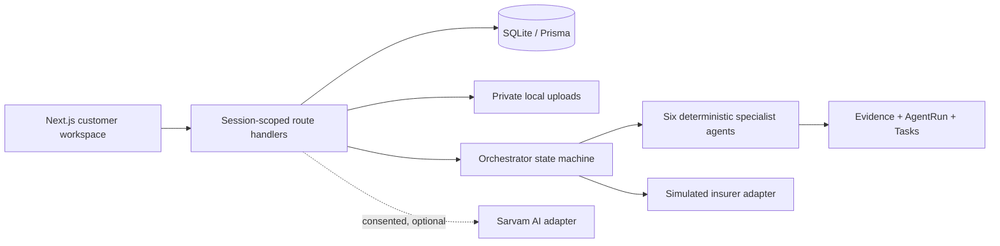

# ClaimSaathi

**Speak your language. Move your claim forward.**

ClaimSaathi is a complete local prototype for Indian health-insurance claim coordination. It gives a patient or family member an evidence-backed answer to: **what is blocking this claim, who needs to act next, and what can I do now?**

It is deliberately honest: policies, people, hospitals and insurer responses are fictional; the insurer is always simulated; and no screen promises a claim decision, coverage, reimbursement, or appeal outcome.

## Quick start

Requires Node.js 18.18+ and a local filesystem that permits SQLite writes.

```bash
pnpm install
pnpm run db:setup
pnpm run db:seed
pnpm run dev
```

Open `http://localhost:3000` and choose **Start the demo** for the single guided customer-to-reviewer journey.

Equivalent npm commands work too:

```bash
npm install
npm run db:setup
npm run dev
```

Useful checks:

```bash
pnpm exec tsc --noEmit
pnpm run test
pnpm run build
```

## What is implemented

- Next.js App Router, TypeScript, Tailwind, Prisma + local SQLite, private local file storage, Zod validation, Vitest tests, and local text-based PDF fixtures.
- HTTP-only demo-session cookie and strict session checks on case, document, export, action, evidence and log access.
- One guided three-role demo: customer uploads a missing sample document, a hospital role checks its receipt, and a payout-consultant role forwards the fictional packet through a simulated insurer and payout result.
- Six separately implemented deterministic specialist agents plus a persisted orchestrator activity trail.
- Document readiness, duplicate prevention, manual field corrections, text extraction for text PDFs/TXT, and explicit manual-transcription state for image/scanned material (no fake OCR).
- Evidence references with document, page, clause, excerpt and extraction state.
- Draft versioning, explicit approval gates, cancellation, and idempotent simulated insurer actions.
- Hindi/English claim questions with automatic device speech replies; connected speech transcription is consent-gated, while outbound claim actions always remain simulated and approval-gated.

## Sarvam configuration

Copy `.env.example` to `.env` and leave `AI_MODE=demo` for the fully working no-key flow. For connected mode:

```dotenv
AI_MODE=sarvam
SARVAM_API_KEY=your_server_only_key
DATABASE_URL="file:./dev.db"
```

Keys are read only on the server. Users must grant purpose-specific consent before voice transcription, translation, text-to-speech or grounded rephrasing. The provider adapter uses timeouts, bounded retries, a local per-capability rate limit, and payload-size limits. No live credentials were used to test this project.

| Capability | Demo mode | Sarvam-connected mode |
| --- | --- | --- |
| Speech input | Clearly labelled sample transcript, confirmed before use | Saaras v4 private backend request |
| Translation | Labelled assistance fallback | Sarvam Translate request after consent |
| Listening | Device speech, labelled demo | Bulbul v4 Flash after consent |
| Grounded explanation | Deterministic evidence-bound answer | Sarvam 105B rephrase after consent and deterministic grounding |

The user-facing product currently enables **English and Hindi**. Sarvam supports more languages, but they are not exposed here until the experience is verified end to end.

## Single guided demo

1. Choose **Start the demo** and ask “I need my claim. What document do I need to add?”
2. The fictional claim already contains its policy, itemised bill, and payment receipt. Download the separate sample discharge summary and upload it.
3. Share the completed packet with the demo role screens.
4. Switch to **Hospital** and verify receipt of the sample document. The role/account chooser appears above the claim details.
5. Switch to **Paytm payout consultant** and submit the packet to the simulated insurer, then display the fictional approval/payout result.
6. Switch back to **Customer** to see the progress notifications and the demo-only credited amount.

The three role tabs share one browser session and are not separate authenticated accounts or permission boundaries. Notifications are in-app demo status, not real SMS, email, or push alerts. The hospital review, insurer acknowledgement/decision, Paytm-style payout review, and credit are synthetic. Paytm and any real insurer/hospital are not connected; no money moves. A payout provider cannot approve an insurance claim.

Claim explanations and role-step confirmations are spoken aloud. In demo mode or before Sarvam consent, the browser uses its device voice. In Sarvam-connected mode, select **Enable Sarvam voice** to explicitly consent to sending response text for speech generation; after consent, replies use Sarvam TTS when available and show a device-voice fallback if it is unavailable.

## Architecture



## Limitations and production requirements

- SQLite and local files are suitable for a single local node, not ephemeral/serverless deployments or multi-instance hosting. Use managed storage and a production database before deployment.
- Insurer calls, policy documents, thresholds, and customer data are fictional. The cashless timer is a configurable, **unverified demo assumption** and is not current regulatory advice.
- OCR is intentionally unavailable. Image and scan uploads are marked for manual transcription.
- This is not a regulated, security-certified, or production-compliance claim service. A production deployment requires legal/regulatory review, provider agreements, encryption/key management, retention controls, monitoring, rate limiting across instances, malware scanning, accessibility review, audit controls, and insurer/TPA integration agreements.
- Never upload Aadhaar, banking credentials, or real medical files to this demo. Use synthetic records.

## Troubleshooting

- Run `pnpm run db:setup` after pulling changes to apply the local database migration and recreate fixtures.
- If OneDrive locks `dev.db` or `.next`, stop running Next processes, wait for sync to release the file, then rerun the command.
- Install browser binaries for local E2E work with `pnpm run test:e2e:install`.
- Connected Sarvam calls return a visible fallback reason on an unavailable key, consent denial, timeout, or provider error; no response is fabricated.
