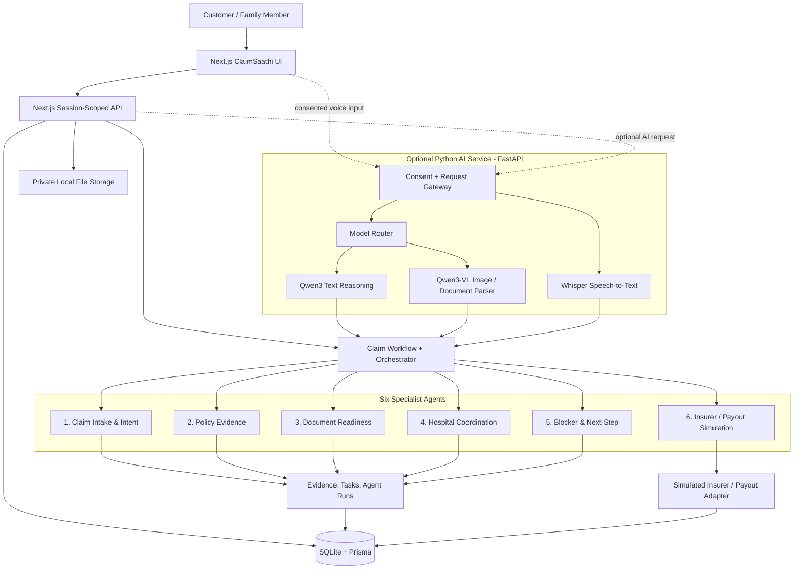
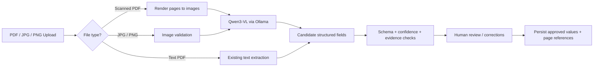

# ClaimSaathi

**Speak your language. Understand your documents. Move your claim forward.**

ClaimSaathi is a local prototype for Indian health-insurance claim coordination. It helps a patient or family member understand three things:

1. What is currently blocking the claim?
2. Which person or role needs to act next?
3. What practical step can the customer take now?

The product is designed around evidence-backed explanations, document readiness, clear responsibility hand-offs, and human approval before any outbound action.

> **Prototype and safety notice**  
> Policies, people, hospitals, insurer responses, and payout events in the demo are fictional. The insurer and payout flow are simulated. ClaimSaathi does not determine real coverage, approve claims, promise reimbursement, or predict appeal outcomes. Never use real patient records or sensitive identity/banking information with this prototype.

---

## 1. Product at a glance

ClaimSaathi combines a Next.js customer experience with a local claim workflow, specialist agents, and an optional local AI model service.

| Layer | Technology / responsibility |
|---|---|
| Web application | Next.js App Router, TypeScript, Tailwind CSS |
| API and validation | Next.js route handlers, Zod, session-scoped access |
| Database | Prisma with local SQLite |
| File handling | Private local file storage and text-PDF fixtures |
| AI service (optional integration) | Python, FastAPI, Pydantic |
| Speech-to-text | OpenAI Whisper, running locally in Python |
| Text reasoning | Qwen3 through Ollama |
| Image and scanned-document understanding | Qwen3-VL through Ollama |
| Workflow | Six deterministic specialist agents coordinated by an orchestrator |
| Voice output | Browser/device speech in demo mode; optional Sarvam TTS after consent |
| Insurer / payout | Fictional simulator; no real insurer or payment provider connection |

**Important implementation distinction:** the existing prototype description confirms the Next.js/Prisma workflow, six deterministic agents, text-PDF extraction, and optional Sarvam integration. The Python + Whisper + Ollama + Qwen3 components in this README describe the **local AI-service integration design**. They should be treated as optional/planned until the corresponding `ai-service` code is present and tested in the repository. The current baseline does not become an OCR-enabled or model-connected system merely by installing these models.

---

## 2. Core features

- Guided customer-to-reviewer journey with customer, hospital, and payout-consultant demo roles.
- One local browser session for the guided role switch; the role tabs are not separate authenticated accounts or security boundaries.
- Claim questions and explanations in English and Hindi.
- Document readiness checks, duplicate prevention, and manual field corrections.
- Evidence references containing document, page, clause, excerpt, and extraction state.
- Draft versioning, approval gates, cancellation, and idempotent simulated insurer actions.
- Persisted orchestrator activity trail and task/status updates.
- Text extraction for text-based PDF and TXT fixtures.
- Explicit manual-transcription state for scanned or image-based documents in the baseline workflow.
- Sample notifications inside the app; they are not real SMS, email, or push messages.
- A simulated insurer acknowledgement/decision and fictional payout result for the guided demo.

---

## 3. AI and model architecture

### End-to-end architecture



The Next.js application remains the product and workflow boundary. The optional Python service is a model-inference boundary: it accepts a specific, consented task, calls a local model, and returns structured candidate output. The orchestrator and deterministic agents remain responsible for workflow state, task ownership, evidence references, and approval gates.

### Model responsibilities

| Component | Model / runtime | What it does | Recommended starting point |
|---|---|---|---|
| Speech recognition | Whisper in Python | Converts a user's Hindi/English voice input into a transcript | `small` for a practical multilingual baseline; test `medium` for better accuracy where hardware permits |
| Claim-language reasoning | Qwen3 via Ollama | Summarises a question, drafts a plain-language explanation, and proposes a next-step response grounded in supplied evidence | `qwen3:4b` for lighter local use; `qwen3:8b` for a stronger local reasoning option |
| Image/document understanding | Qwen3-VL via Ollama | Reads page images, identifies document type, and proposes visible field values from scans or photos | `qwen3-vl:4b` as a starting point; consider `qwen3-vl:8b` if the machine has more available memory |
| Workflow decisions | Deterministic Python/TypeScript rules and six specialist agents | Checks required fields, evidence links, task ownership, approvals, and permitted state transitions | Keep deterministic; do not delegate claim decisions to an LLM |

Model size labels are not a guarantee of speed or accuracy on a particular computer. Benchmark with synthetic documents on the target hardware before choosing a default.

### Why use separate models?

- **Whisper** is a speech-recognition model. It transcribes the user's audio; it does not decide claim eligibility.
- **Qwen3** is the text model for summarisation and natural-language explanations. It should receive only the minimum relevant, redacted context.
- **Qwen3-VL** is a vision-language model for image inputs. It can inspect a rendered document page and return candidate text/fields; its output must be treated as unverified until checked against the original page.
- **The orchestrator** is not the language model. It owns the workflow state and invokes specialist agents in a controlled sequence.

---

## 4. The six specialist agents

The specialist agents are deliberately narrow. Each agent should return a structured result, identify the evidence it used, and avoid changing claim state unless the action is explicitly permitted.

| Agent | Responsibility | Example output |
|---|---|---|
| **1. Claim Intake & Intent Agent** | Understands the customer's question and identifies the task they are asking about. | Intent: `missing_document`; requested help: `what_to_upload` |
| **2. Policy Evidence Agent** | Locates relevant policy text and returns only evidence-backed explanations. | Clause reference, page number, short excerpt, and extraction status |
| **3. Document Readiness Agent** | Checks whether expected documents are present, readable, duplicated, and complete enough for review. | Missing discharge summary; possible duplicate bill; amount field needs confirmation |
| **4. Hospital Coordination Agent** | Tracks hospital-side receipt and review tasks in the demo workflow. | Hospital receipt pending / sample document received |
| **5. Blocker & Next-Step Agent** | Combines current tasks, document checks, and evidence to identify the blocker and responsible next actor. | Blocker: missing document; next actor: customer; suggested action: upload sample discharge summary |
| **6. Insurer / Payout Simulation Agent** | Runs the fictional insurer and payout-consultant stages used by the local demonstration. | Simulated packet acknowledgement and demo-only payout status |

### Orchestrator responsibilities

The orchestrator coordinates the six specialists. It should:

1. Load the session-scoped claim and its current workflow state.
2. Select only the agents needed for the current user request or workflow event.
3. Pass the minimum required context and document/evidence references.
4. Validate each agent's structured output.
5. Persist agent runs, evidence references, tasks, and status transitions.
6. Enforce approval gates before any outbound or simulated action.
7. Return a customer-friendly explanation of the blocker, next owner, and next step.

**Agent design rule:** an LLM may suggest an interpretation, but deterministic validation must decide whether the suggestion is complete, supported, and permitted. An LLM must never invent a policy clause, page number, insurer response, approval, or payment.

---

## 5. Image and document parsing

### Proposed image parsing flow



**Suggested model:** `qwen3-vl:4b` for the first local implementation. Qwen3-VL accepts image input and is designed for visual understanding and text recognition. For a scanned PDF, render each page to an image first and send the relevant page image to the model. Do not send an entire large PDF as an unbounded request.

Example fields that a parser may propose:

```json
{
  "document_type": "discharge_summary",
  "hospital_name": "Example General Hospital",
  "patient_name": "Sample Patient",
  "admission_date": "2026-10-20",
  "discharge_date": "2026-10-24",
  "doctor_name": null,
  "extraction_status": "requires_human_review",
  "source_page": 1
}
```

The values above are illustrative only. The parser must return `null` when a field is not visible or cannot be read. Do not infer missing dates, names, diagnosis details, amounts, or policy numbers.

### Evidence and verification rules

- Store the original uploaded file and the page number used for each extracted candidate field.
- Preserve the model output separately from user-corrected and approved values.
- Require human confirmation for names, dates, policy identifiers, bill totals, payment amounts, and other high-impact fields.
- Never treat model-generated text as a policy clause. Policy evidence must point to the actual uploaded policy text/page and excerpt.
- Mark blurry, cropped, rotated, low-resolution, or conflicting fields as `requires_human_review`.
- Keep a visible extraction state such as `model_candidate`, `manual_transcription`, `verified`, or `unreadable`.
- Do not silently overwrite a previously verified value with a new model prediction.

This is an AI-assisted document-reading design, not a guarantee of accurate OCR or a replacement for manual review.

---

## 6. Voice interaction

### Incoming voice

1. The user chooses the voice-input control and is shown why audio is being processed.
2. The user grants purpose-specific consent before audio is sent to a transcription service.
3. In the local AI-service option, Python runs Whisper and returns a transcript.
4. The transcript is displayed to the user for confirmation or correction.
5. Only after confirmation is the text passed to the claim-intake workflow.

For Hindi/English or code-mixed speech, start with Whisper's multilingual `small` model and test representative Hindi, English, and Hinglish recordings. For higher accuracy, benchmark `medium` on the target machine. Speech recognition can mishear names, amounts, dates, and medical terms, so show the transcript before acting on it.

### Outgoing voice

- The baseline demo uses browser/device speech.
- Sarvam TTS can be used in connected mode only after the user gives the required consent.
- The browser voice remains a visible fallback if the connected provider is unavailable.
- Whisper is used for input transcription, not text-to-speech.

---

## 7. Quick start: existing ClaimSaathi demo

### Requirements

- Node.js 18.18 or newer.
- pnpm (recommended) or npm.
- A local filesystem that permits SQLite writes.

### Install and run

```bash
pnpm install
pnpm run db:setup
pnpm run db:seed
pnpm run dev
```

Open [http://localhost:3000](http://localhost:3000) and select **Start the demo**.

Equivalent npm commands:

```bash
npm install
npm run db:setup
npm run dev
```

Useful checks:

```bash
pnpm exec tsc --noEmit
pnpm run test
pnpm run build
```

---

## 8. Optional local AI stack: Python + Whisper + Ollama

This section describes the intended local model service. It is not part of the baseline quick-start unless the matching Python service has been added to the repository.

### 8.1 Install Ollama and download models

Install Ollama from [ollama.com](https://ollama.com/), then use PowerShell or a terminal:

```powershell
ollama --version
ollama pull qwen3:4b
ollama pull qwen3-vl:4b
ollama list
```

Run the text model:

```powershell
ollama run qwen3:4b
```

Run the vision model:

```powershell
ollama run qwen3-vl:4b
```

Qwen3-VL requires Ollama **0.12.7 or newer**. If the vision model fails to load, update Ollama before troubleshooting the Python code.

Suggested local model profiles:

| Profile | Text model | Vision model | When to use |
|---|---|---|---|
| Lower-resource starting point | `qwen3:4b` | `qwen3-vl:4b` | First local prototype; validate speed and memory on your machine |
| Higher-quality local option | `qwen3:8b` | `qwen3-vl:8b` | Use when the machine has sufficient RAM/VRAM and latency is acceptable |

Only pull one profile initially to avoid using disk space unnecessarily.

### 8.2 Create a Python environment

Use Python 3.10 or 3.11 as a practical compatibility target for the Whisper package:

```powershell
py -3.11 -m venv .venv
.\.venv\Scripts\Activate.ps1
python -m pip install --upgrade pip
```

Install the packages for a proposed FastAPI inference service:

```powershell
pip install fastapi "uvicorn[standard]" python-multipart pydantic ollama openai-whisper pymupdf pillow
```

Whisper also requires **FFmpeg** on the system path. Follow the [FFmpeg installation guide](https://ffmpeg.org/download.html) for Windows, macOS, or Linux.

### 8.3 Suggested Python service layout

The following is a target structure for the optional integration; create these files when implementing the service:

```text
ClaimSaathi/
├── app/                         # Existing Next.js application
├── prisma/
├── storage/                     # Private synthetic demo uploads
└── ai-service/
    ├── app/
    │   ├── main.py              # FastAPI application
    │   ├── config.py             # Model names and service settings
    │   ├── schemas.py            # Pydantic request/response schemas
    │   ├── api/
    │   │   ├── speech.py         # Whisper transcription endpoint
    │   │   ├── documents.py      # Page-image parsing endpoint
    │   │   └── claims.py         # Evidence-grounded explanation endpoint
    │   ├── models/
    │   │   ├── whisper_model.py  # Whisper loading and transcription
    │   │   └── ollama_client.py  # Qwen3 / Qwen3-VL calls
    │   ├── agents/
    │   │   ├── orchestrator.py
    │   │   ├── intake_agent.py
    │   │   ├── policy_agent.py
    │   │   ├── document_agent.py
    │   │   ├── hospital_agent.py
    │   │   ├── blocker_agent.py
    │   │   └── payout_simulation_agent.py
    │   └── document_parser/
    │       ├── pdf_renderer.py
    │       └── extraction_validator.py
    ├── tests/
    └── requirements.txt
```

Avoid loading Whisper or a large Ollama model on every HTTP request. Load or warm the model once per worker, limit concurrent inference, and set request/file-size limits.

### 8.4 Example environment configuration

These are suggested settings for the optional Python service. The current application will ignore them until the corresponding integration is implemented.

```dotenv
# Existing application settings
AI_MODE=demo
DATABASE_URL="file:./dev.db"

# Optional local AI service
AI_SERVICE_URL=http://127.0.0.1:8000
OLLAMA_BASE_URL=http://127.0.0.1:11434
OLLAMA_TEXT_MODEL=qwen3:4b
OLLAMA_VISION_MODEL=qwen3-vl:4b
WHISPER_MODEL=small
```

Do not place provider keys in browser-exposed variables. Keep credentials on the server and apply consent checks before processing audio or documents.

### 8.5 Minimal Python model smoke tests

These snippets help verify the models locally before connecting them to FastAPI. They are standalone examples, not existing application endpoints.

**Whisper transcription** (`ai-service/whisper_smoke_test.py`):

```python
from pathlib import Path
import whisper


def transcribe_audio(audio_file: str, model_name: str = "small") -> str:
    audio_path = Path(audio_file)
    if not audio_path.is_file():
        raise FileNotFoundError(f"Audio file not found: {audio_path}")

    model = whisper.load_model(model_name)
    result = model.transcribe(
        str(audio_path),
        task="transcribe",
        language=None,  # Let Whisper detect the spoken language.
        fp16=False,     # Safe default for CPU; use GPU-specific tuning when available.
    )
    return str(result.get("text", "")).strip()


if __name__ == "__main__":
    print(transcribe_audio("sample_audio.wav"))
```

**Qwen3 text reasoning** (`ai-service/qwen_text_smoke_test.py`):

```python
import os
from ollama import chat

MODEL = os.getenv("OLLAMA_TEXT_MODEL", "qwen3:4b")

response = chat(
    model=MODEL,
    messages=[
        {
            "role": "system",
            "content": (
                "Explain only the supplied synthetic claim facts. "
                "Do not infer coverage or invent policy clauses."
            ),
        },
        {
            "role": "user",
            "content": (
                "Demo case: the policy, itemised bill, and payment receipt "
                "are present; the discharge summary is missing. "
                "Explain the blocker and next action in simple English."
            ),
        },
    ],
)

print(response.message.content)
```

**Qwen3-VL image parsing** (`ai-service/qwen_vision_smoke_test.py`):

```python
import os
from pathlib import Path
from ollama import chat

MODEL = os.getenv("OLLAMA_VISION_MODEL", "qwen3-vl:4b")
IMAGE = Path("sample_document_page.png")

if not IMAGE.is_file():
    raise FileNotFoundError(f"Image not found: {IMAGE}")

response = chat(
    model=MODEL,
    messages=[
        {
            "role": "user",
            "content": (
                "Read the visible document page. Return JSON only with "
                "document_type, hospital_name, admission_date, discharge_date, "
                "visible_text_summary, and fields_requiring_human_review. "
                "Use null for unreadable or absent values. Do not guess."
            ),
            "images": [str(IMAGE)],
        }
    ],
)

print(response.message.content)
```

Before using the vision result in a claim, parse it against a strict schema, retain the image/page reference, and require a human to confirm high-impact values.

### 8.6 Suggested local service run command

After creating the optional `ai-service` files and its dependency list:

```powershell
cd ai-service
uvicorn app.main:app --reload --host 127.0.0.1 --port 8000
```

The Next.js server can then call the private Python service at `http://127.0.0.1:8000`. Do not expose the model service directly to the public internet without authentication, request limits, and deployment hardening.

---

## 9. Sarvam configuration

The existing prototype supports a deterministic demo mode and an optional Sarvam-connected mode.

Copy `.env.example` to `.env` and keep `AI_MODE=demo` for the no-key demo. To enable the existing Sarvam adapter:

```dotenv
AI_MODE=sarvam
SARVAM_API_KEY=your_server_only_key
DATABASE_URL="file:./dev.db"
```

Keys are read only on the server. Purpose-specific consent is required before voice transcription, translation, text-to-speech, or grounded rephrasing. The provider adapter uses timeouts, bounded retries, a local per-capability rate limit, and payload-size limits. No live credentials were used to test this project.

| Capability | Demo mode | Sarvam-connected mode |
|---|---|---|
| Speech input | Clearly labelled sample transcript, confirmed before use | Saaras v4 backend request after consent |
| Translation | Labelled assistance fallback | Sarvam Translate request after consent |
| Listening | Device/browser speech | Bulbul v4 Flash after consent, with device-voice fallback |
| Grounded explanation | Deterministic evidence-bound answer | Sarvam 105B rephrase after consent, followed by deterministic grounding |

The user-facing product currently exposes English and Hindi only. Additional languages should not be enabled until tested end to end.

---

## 10. Single guided demo

1. Choose **Start the demo** and ask: “I need my claim. What document do I need to add?”
2. The fictional claim already contains its policy, itemised bill, and payment receipt. Download the separate sample discharge summary and upload it.
3. Share the completed packet with the demo role screens.
4. Switch to **Hospital** and verify receipt of the sample document. The role/account chooser appears above the claim details.
5. Switch to **Paytm payout consultant** and submit the packet to the simulated insurer, then display the fictional approval/payout result.
6. Switch back to **Customer** to see the progress notifications and demo-only credited amount.

The three role tabs share one browser session and are not separate authenticated accounts or permission boundaries. The hospital review, insurer acknowledgement/decision, Paytm-style payout review, and credit are synthetic. Paytm and any real insurer/hospital are not connected; no money moves. A payout provider cannot approve an insurance claim.

Claim explanations and role-step confirmations are spoken aloud. In demo mode, or before Sarvam consent, the browser uses its device voice. In Sarvam-connected mode, select **Enable Sarvam voice** to explicitly consent to sending response text for speech generation; if Sarvam TTS is unavailable, the app shows a device-voice fallback.

---

## 11. Security, privacy, and safety boundaries

- Use synthetic claimants, policies, hospitals, bills, receipts, and discharge summaries only.
- Never upload Aadhaar, PAN, bank details, insurance credentials, real medical files, or other sensitive personal information to this prototype.
- Keep local uploads private and outside public/static web directories.
- Enforce session checks on case, document, export, action, evidence, and log routes.
- Apply strict file size, file type, and page-count limits before parsing.
- Treat audio transcripts and model outputs as untrusted user-content, not as instructions.
- Require explicit consent before sending audio or other content to an external provider.
- Require human confirmation for model-extracted high-impact fields.
- Keep approval gates and idempotency checks around every outbound action.
- Record evidence provenance and extraction state; do not fabricate source references.
- Never let an LLM call the insurer, approve coverage, create a payment, or bypass the deterministic workflow.

---

## 12. Limitations and production requirements

- SQLite and local files are suitable for a single local node, not ephemeral/serverless deployments or multi-instance hosting. Use a managed database and private object storage before production deployment.
- The insurer, policies, thresholds, customer data, hospital review, and payout result in the demo are fictional.
- The cashless timer is a configurable, unverified demo assumption and is not current regulatory advice.
- The baseline implementation extracts text from text-based PDFs and TXT fixtures. Scanned/image documents require manual transcription unless the optional Qwen3-VL integration is implemented and verified.
- A vision-language model can misread poor scans, tables, stamps, handwriting, and similar-looking digits. Human verification remains mandatory.
- The prototype is not a regulated, security-certified, or production-compliance claim service.
- A production deployment requires legal/regulatory review, provider agreements, encryption and key management, retention controls, monitoring, cross-instance rate limiting, malware scanning, accessibility review, audit controls, secure authentication/authorization, and insurer/TPA integration agreements.

---

## 13. Troubleshooting

**SQLite or `.next` file is locked**  
Stop running Next.js processes, ensure OneDrive or another sync tool is not locking the files, and rerun the database setup command.

**Database fixtures are missing**  
Run:

```bash
pnpm run db:setup
pnpm run db:seed
```

**Whisper cannot find FFmpeg**  
Install FFmpeg, add its executable directory to `PATH`, restart the terminal, and verify with:

```powershell
ffmpeg -version
```

**Ollama model is unavailable**  
Check the service and downloaded models:

```powershell
ollama --version
ollama list
```

Pull the required model if it is missing. For Qwen3-VL, confirm that Ollama is version 0.12.7 or newer.

**Qwen3-VL cannot read the uploaded PDF**  
Render the relevant PDF page to PNG/JPEG first, then pass the image to the vision model. Validate the returned fields against the original page; do not treat model output as verified evidence.

**Sarvam call falls back**  
Check the server-side key, consent state, network access, provider availability, and the fallback reason shown by the application. No response should be fabricated when a provider call fails.

---

## 14. Useful references

- [Ollama — Qwen3 model library](https://ollama.com/library/qwen3)
- [Ollama — Qwen3-VL model library and model tags](https://ollama.com/library/qwen3-vl)
- [Ollama — Vision capabilities](https://github.com/ollama/ollama/blob/main/docs/capabilities/vision.mdx)
- [OpenAI Whisper — GitHub repository and installation instructions](https://github.com/openai/whisper)
- [FFmpeg — official download page](https://ffmpeg.org/download.html)
- [FastAPI — official documentation](https://fastapi.tiangolo.com/)

---

**ClaimSaathi — Speak your language. Move your claim forward.**
