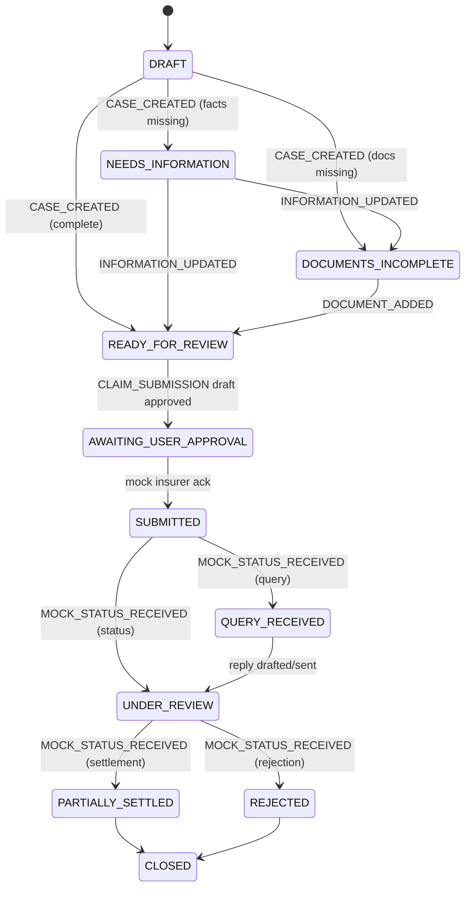

# ClaimSaathi — Architecture

A demo-first, multilingual, multi-agent health insurance claims assistant.
Next.js App Router monolith (no microservices, no Redis, no vector DB).
Persistence: Prisma + SQLite (local file). Storage: private local `data/`
directory (outside `public/`).

## System overview

```mermaid
flowchart TB
    subgraph Browser
        UI[Next.js App Router UI<br/>Dashboard · Wizard · Workspace<br/>shadcn/ui · Tailwind · i18n EN/HI]
        VOICE[Voice recorder<br/>MediaRecorder]
        TTS[Audio player<br/>Listen]
    end

    subgraph Server["Next.js server (Node runtime)"]
        subgraph API["Route handlers (session-scoped)"]
            CLAIMS[/api/claims*]
            DOCS[/api/claims/[id]/documents*]
            ACTIONS[/api/claims/[id]/actions*]
            DEMO[/api/demo/*]
            SARVAM_R[/api/sarvam/*]
        end

        ORCH[Orchestrator<br/>state machine · event routing<br/>approval gate · draft versioning<br/>idempotent submission]

        subgraph AGENTS["Specialist agents (pure modules)"]
            A1[Intake & Routing]
            A2[Policy Evidence]
            A3[Document Readiness]
            A4[Claim Coordination]
            A5[Timeline & Delay Watch]
            A6[Settlement & Appeal]
            ASST[Contextual assistant]
        end

        DOCLIB[Document extraction<br/>pdfjs-dist · text · field heuristics]
        EVID[Evidence store<br/>clause index · keyword retrieval]
        SARVAM[SarvamProvider<br/>STT · Translate · TTS · Chat<br/>timeout · retry · rate limit]
        MOCK[Mock insurer adapter<br/>deterministic · logged]
        CONSENT[Consent gate]
    end

    subgraph Store["Local persistence"]
        SQLITE[(SQLite via Prisma<br/>cases · runs · events<br/>evidence · approvals · logs)]
        FILES[(data/uploads & data/audio<br/>per-session private files)]
    end

    subgraph External["External (connected mode only)"]
        SARVAM_API[Sarvam AI API<br/>api.sarvam.ai]
    end

    UI -->|JSON API| API
    VOICE -->|confirmed transcript| SARVAM_R
    TTS -->|base64 audio| SARVAM_R
    CLAIMS --> ORCH
    DOCS --> DOCLIB
    DEMO --> MOCK
    SARVAM_R --> CONSENT --> SARVAM
    SARVAM -.->|AI_MODE=sarvam| SARVAM_API
    ORCH --> AGENTS
    AGENTS --> EVID
    ORCH --> MOCK
    ORCH --> SQLITE
    DOCLIB --> FILES
    MOCK --> SQLITE
    EVID --> SQLITE
    ASST --> ORCH
```

## Runtime modes

| | Demo (default) | Sarvam connected |
|---|---|---|
| Agents | Deterministic rule-based modules | Same deterministic modules |
| Voice input | Labelled sample transcripts | Sarvam `saaras:v4` STT |
| Translation | Prepared EN↔HI translations | Sarvam `mayura:v1` / `sarvam-translate:v1` |
| Speech output | Device speech (labelled) | Sarvam `bulbul:v3/v4-flash` TTS |
| Grounded generation | Deterministic assistant | `sarvam-105b` chat completions (optional) |
| Insurer | Simulated | Simulated (always) |

## Orchestration

Events: `CASE_CREATED`, `DOCUMENT_ADDED`, `INFORMATION_UPDATED`,
`ANALYSIS_REQUESTED`, `ACTION_APPROVED`, `ACTION_CANCELLED`,
`MOCK_STATUS_RECEIVED`, `SIMULATED_TIME_ADVANCED`.



Agent routing (only the agents an event needs; independent checks run in
parallel):

| Trigger | Agents |
|---|---|
| CASE_CREATED | Intake; then Policy Evidence ∥ Document Readiness |
| DOCUMENT_ADDED | Document Readiness (+ Policy Evidence if policy doc) |
| INFORMATION_UPDATED | Intake (+ Readiness when doc-adjacent) |
| ANALYSIS_REQUESTED | Routed by state (see contracts) |
| ACTION_APPROVED | Coordination → mock adapter → MOCK_STATUS_RECEIVED |
| MOCK_STATUS_RECEIVED | Coordination (+ Settlement on settlement/rejection) |
| SIMULATED_TIME_ADVANCED | Delay Watch |

Every agent run persists an `AgentRun` (queued → running → completed/blocked/
failed), a Zod-validated `AgentOutput`, tool logs, and evidence references —
this is what the Agent Activity drawer renders (polling).

## Data & privacy

- HTTP-only session cookie `claimsathi_sid`; every query/filter/download is
  scoped to the session.
- Uploads stored per session under `data/uploads/<session>/`; audio under
  `data/audio/` (deleted after processing).
- Magic-byte sniffing + size/type limits; filenames sanitized; extracted text
  rendered as plain text only (never as HTML).
- Document text is untrusted data: agents treat it as data only; documents
  cannot approve actions or invoke tools.
- Fictional policy/insurer/hospital/patient data; all insurer interactions
  simulated and labelled; no compliance/regulatory claims.

## Known limitations (see README for the full list)

- SQLite: single-node persistence; local file storage is not multi-instance.
- Text-based PDFs only (pdfjs-dist); scanned PDFs/images need manual
  transcription (no OCR).
- Sarvam integration verified against official docs but not exercised with
  live credentials in this build.
- SLA thresholds are labelled unverified demo assumptions.
